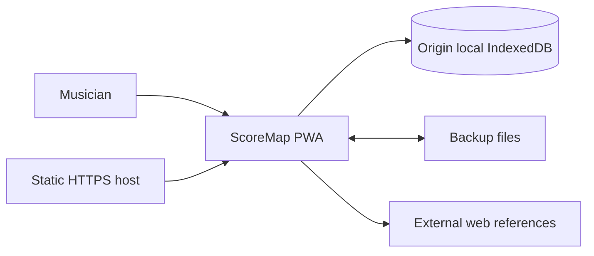

# 3. System scope and context

The musician supplies text, chord choices, backup files and optional PDFs. ScoreMap writes browser-origin IndexedDB and downloads backup files. A static HTTPS host delivers only application assets. External reference targets open in another browsing context.

<!-- pdac:cite id="CON-CONTENT" digest="sha256:5c08415cc8047dfc3161440d4a427675c191cd7bfecef5d3c7bb139fe0a9752e" -->

Connectivity is needed for first asset delivery and external web content. Locally stored content is independent of those targets.

<!-- pdac:cite id="FR-OFFLINE" digest="sha256:f39bedc59d2b0506bd49854b84996662f18997159a708d204b54ddecc3c910c1" -->

## Accepted evolution context

The preceding context describes the browser-only alpha. Under [ADR-0003](../09-architecture-decisions/ADR-0003-self-host-the-private-application-with-aspire.md), the PWA additionally talks to a private same-origin BFF/API through protected ingress. The operator-managed backend and PostgreSQL form the acknowledged library authority; each device retains only the approved offline/pending-work scope. Identity integration is a trusted server-side boundary, with its production provider still to be selected in #20/#25. No managed cloud service is implied.

The musician's browser and submitted IDs/roles are untrusted input. Authentication at ingress is not song authorization. The operator supplies the private deployment configuration but it is not public product data. [Section 07](../07-deployment-view/README.md) owns the environment mapping, and [section 08](../08-crosscutting-concepts/README.md) owns admission, token/session and transaction mechanisms. This target requires #20's validated Product Change; it is not implemented by this context update.
