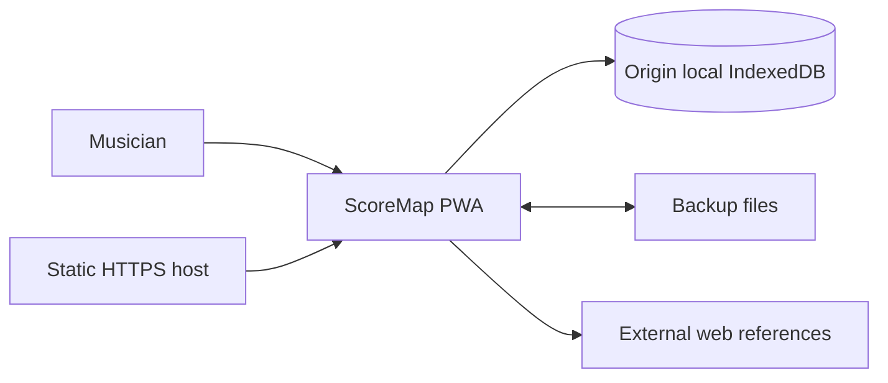

# 3. System scope and context

The musician supplies text, chord choices, backup files and optional PDFs. ScoreMap writes browser-origin IndexedDB and downloads backup files. A static HTTPS host delivers only application assets. External reference targets open in another browsing context.

<!-- pdac:cite id="CON-CONTENT" digest="sha256:5c08415cc8047dfc3161440d4a427675c191cd7bfecef5d3c7bb139fe0a9752e" -->

Connectivity is needed for first asset delivery and external web content. Locally stored content is independent of those targets.

<!-- pdac:cite id="FR-OFFLINE" digest="sha256:68f558e306eea39e0a533194ce6429c4c97180f94aabca6bbb6ca6a174f9cb0f" -->
