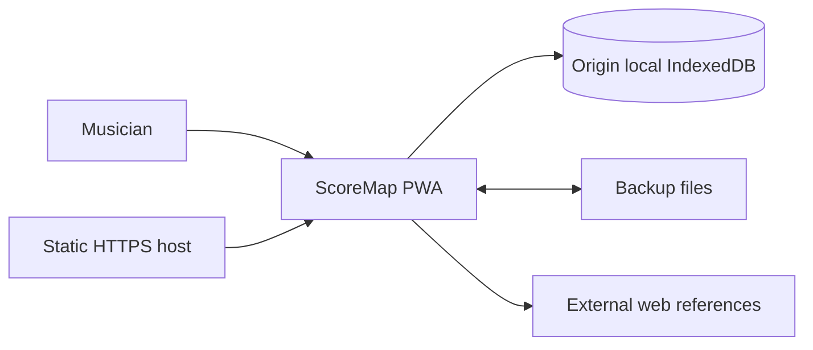

# 3. System scope and context

In the anonymous browser context, the musician supplies text, chord choices, backup files and optional PDFs. ScoreMap writes browser-origin IndexedDB and downloads backup files. A static HTTPS host delivers only application assets. External reference targets open in another browsing context.

<!-- pdac:cite id="CON-CONTENT" digest="sha256:5c08415cc8047dfc3161440d4a427675c191cd7bfecef5d3c7bb139fe0a9752e" -->

In this browser context, connectivity is needed for first asset delivery and external web content. Locally stored content is independent of those targets.

<!-- pdac:cite id="FR-OFFLINE" digest="sha256:f39bedc59d2b0506bd49854b84996662f18997159a708d204b54ddecc3c910c1" -->

## Private application context

The preceding context describes the browser-only alpha. Under [ADR-0003](../09-architecture-decisions/ADR-0003-self-host-the-private-application-with-aspire.md), the PWA additionally talks to a private same-origin BFF/API through protected ingress. The operator-managed backend and PostgreSQL form the acknowledged library authority; each device retains only the approved offline/pending-work scope. Identity integration is a trusted server-side boundary, using the operator-selected production OIDC configuration. No managed cloud service is implied.

The musician's browser and submitted IDs/roles are untrusted input. Authentication at ingress is not song authorization. The operator supplies the private deployment configuration but it is not public product data. [Section 07](../07-deployment-view/README.md) owns the environment mapping, and [section 08](../08-crosscutting-concepts/README.md) owns admission, token/session and transaction mechanisms. The validated ProductShape change is retained under `docs/product/changes/completed/chg-arrangement-evolution`; the implemented boundary is visible in the API host and Library module. Actual host/origin allocation remains private operator configuration.

## Native Android target context

[ADR-0010](../09-architecture-decisions/ADR-0010-build-a-separate-native-android-application.md) selects an independently installed local Android application. Its target authority is this installation's local store, with no account, identity provider, BFF or network dependency for local editing and recovery. Portable song/set files cross an explicit validation and confirmation boundary through Android document/share facilities; imported files confer no private-service authority. External links still depend on their external targets.

[Android target](../05-building-block-view/android-target.md) owns native components and persistence/transfer boundaries. This context records the owner-selected architecture; implemented file routes, device installation and complete independent-installation transfer require separate evidence.
