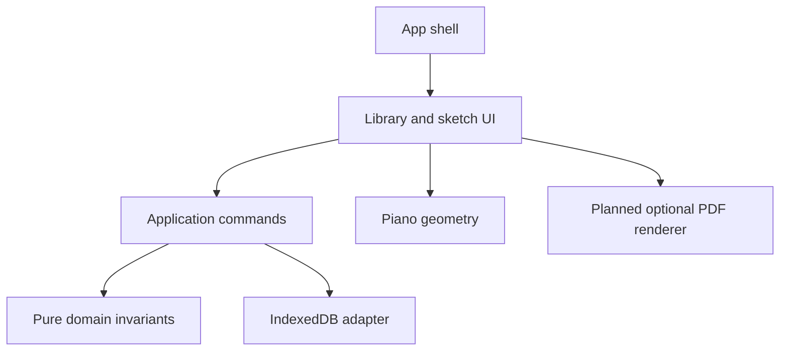
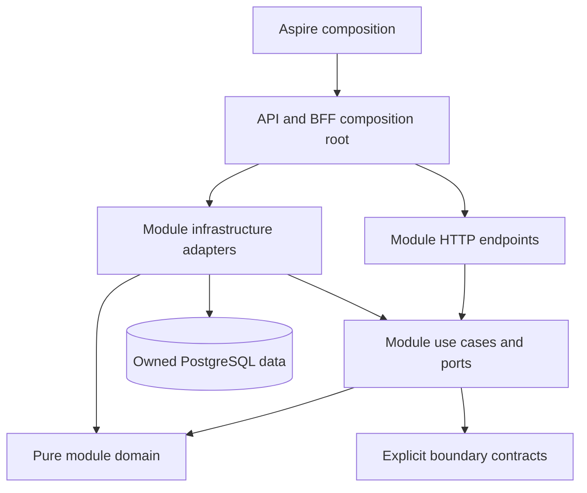
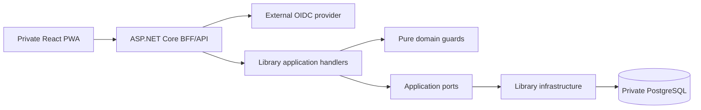

# 5. Building block view

The UI invokes application commands; commands apply pure domain operations and commit complete validated snapshots through the storage adapter. Musical parsing and geometry are independent of rendered components. The PWA worker caches application assets, never library records. The optional PDF renderer is planned in issue #13 and is not implemented in this build. Backups containing PDFs are rejected explicitly until that capability can be verified.

<!-- pdac:cite id="BR-IDENTITY" digest="sha256:6b3d38400ae82fdc926ae2b7a9eee5d02e684c50502545f323adc41cea150768" -->

## Feature modules with enforced logical layers

The Library module and API composition implement these logical boundaries. See [ADR-0004](../09-architecture-decisions/ADR-0004-enforce-feature-and-layer-boundaries-with-executable-checks.md). The applied Product Change #20 defines the domain boundaries used by these projects. Start with the smallest useful module set; neither a keyboard, hand, layer nor candidate domain concept automatically warrants a module.

| Block / layer | Responsibility and permitted dependencies |
| --- | --- |
| React application | `app` composes features; features depend on their own internals and shared primitives. No peer-feature or upward imports except explicitly reviewed public boundaries. API DTOs come from the generated OpenAPI contract. Existing pure browser music functions remain reusable, not an authorization authority. |
| API / BFF host | Single composition root, session and HTTP policies, error mapping and module registration. Feature Minimal API endpoints invoke use cases, never EF Core/DbContext directly. No business rules in host bootstrap or AppHost. |
| Module application / use cases | Commands and read-only queries coordinate domain rules and explicit ports. Internal sealed typed handlers; authorization and validation precede mutation even outside HTTP. No ASP.NET Core, EF Core, Npgsql or transport-specific types in use-case logic. |
| Module domain | Pure musical rules, identity, value objects and invariants. No React/browser, ASP.NET Core, EF Core, database, serialization, identity-provider or Aspire dependencies. Notation formatting and physical keyboard geometry do not define stored musical meaning. |
| Module contracts | Explicit integration/request/response DTOs and interfaces only where a real consumer exists. No public domain entities, DbContext, persistence models or IQueryable, including nested generic payloads. |
| Module infrastructure | Implements application ports; owns persistence mapping, provider adapters and transaction mechanics. EF Core is used here directly; no mandatory generic repository. Other modules cannot access its DbContext, tables or implementation types. |
| Aspire composition / deployment | References deployable artifacts and declared resources, not handlers or musical logic. Development and production composition satisfy different contracts in [section 07](../07-deployment-view/README.md). |

Logical dependencies, not a requirement for one assembly per box:

Modules follow the installed Lighthouse naming/activation contract: implementation assembly family `<Root>.Modules.<Name>`, optional separately consumed `.Contracts` assemblies, analyzer-only references and `LighthouseModule=true`. Feature slices may keep logical domain/application/infrastructure namespaces in one module assembly; semantic checks must enforce those internal boundaries. Do not name separate layer assemblies as sibling module implementations and then disable LH1002 to make them compile. A different physical layout requires an explicit compatibility decision and equivalent rejection tests before adoption.

The API host may compose all modules, but one module may reference another only through its explicit contracts. Approved base dependencies and public exports form an allowlist, not a broad wildcard. Shared code is small and demonstrably shared, not a back door around module ownership. Cross-module changes use explicit application operations within the accepted commit aggregate; no direct foreign-table writes. Separate DbContexts/schemas are justified by actual ownership, not mandated per noun. [Section 10](../10-quality-requirements/README.md) requires source, evaluated project and compiled-boundary checks because none alone proves all these rules.

## Private application implementation

The private application has an API/BFF host and one Library implementation module alongside the anonymous PWA. The host composes framework identity/session/CSRF policy; HTTP mappings invoke typed application handlers. Domain validation is independent of web and database frameworks. The Library infrastructure owns PostgreSQL records, immutable song snapshots, conditional transactions and principal-scoped grants. The same module supplies the protected BFF session/recovery adapters through application ports.

Source: [API host](../../../src/root/ScoreMap.Api/Program.cs), [module composition](../../../src/modules/ScoreMap.Modules.Library/LibraryModule.cs), [domain validation](../../../src/modules/ScoreMap.Modules.Library/Domain/LibraryDocument.cs), [transaction adapter](../../../src/modules/ScoreMap.Modules.Library/Infrastructure/LibraryRepository.cs). These components are integrated through PR37. The environment-specific deployment and current artifact qualification remain separate facts.

<!-- pdac:cite id="FR-PERSIST" digest="sha256:5f901e669e39923921cd1d28302b3f308460a72bda3bce53d83ffa7255934cd4" -->
