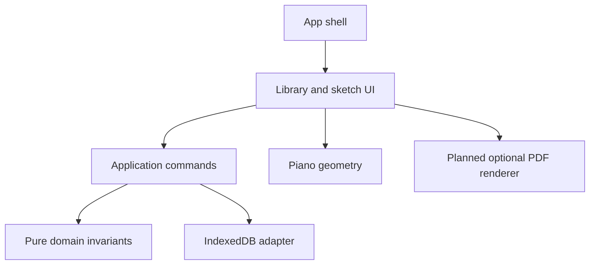

# 5. Building block view

The UI invokes application commands; commands apply pure domain operations and commit complete validated snapshots through the storage adapter. Musical parsing and geometry are independent of rendered components. The PWA worker caches application assets, never library records. The optional PDF renderer is planned in issue #13 and is not implemented in this build. Backups containing PDFs are rejected explicitly until that capability can be verified.

<!-- pdac:cite id="BR-IDENTITY" digest="sha256:170ef1aff15cc46041fca58b4bdda33db26b4ba91b44de4fe2aeded7a9dede67" -->

