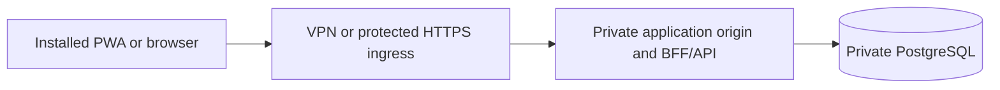

# 7. Deployment view

## Current alpha

The alpha deployment contract is a static HTTPS origin with Vite-built assets, a manifest, icons and a service worker. Its original static hosting choice does not constrain the next self-hosted deployment. The project has no Wrangler deployment dependency. Build: `npm ci --ignore-scripts && npm run build`; output: `dist`; Node 24. Deployment status is recorded in delivery evidence, not inferred from source integration.

<!-- pdac:cite id="CON-PLATFORM" digest="sha256:635e50e18ab13a558ff7fb34323fb9c54c651858935b841272e22ce860067fbb" -->

The origin is part of data ownership: moving domains does not migrate IndexedDB. Export/import provides explicit transfer. Android-compatible browser testing can verify the web runtime; physical tablet installation remains a separate acceptance step.

## Accepted target: development is not production

[ADR-0003](../09-architecture-decisions/ADR-0003-self-host-the-private-application-with-aspire.md) selects self-hosting with Aspire. This is a deployment contract for subsequent implementation; no backend, production composition or deployment is delivered by this document. The physical destination does not define the environment: an operator-managed machine can host a production deployment regardless of its location or name.

| Environment | Building blocks and operating contract |
| --- | --- |
| Development | Aspire AppHost composes the API/BFF, React development server and PostgreSQL. Development-only identity/test data and diagnostics are isolated, labeled and gated by Development. Local volume persistence is explicit; reset never targets production data. |
| Automated integration | Isolated Aspire/application stack, real PostgreSQL and synthetic principals/content. Deterministic seed/reset and resource cleanup affect only execution-owned test resources. No dependency on personal production credentials or arrangements. |
| Production | Versioned built PWA and API/BFF artifacts plus PostgreSQL, published through an Aspire Docker Compose deployment composition. Operator supplies private target/ingress/identity/secrets. Production startup fails closed for missing required configuration, development identity, seeded users or in-memory persistence fallbacks. |

Production does not mean running Vite, a developer login bypass or a publicly exposed dashboard. Conversely, Aspire is not restricted to development: its production composition publishes the operator-deployable artifacts. Use explicit development and deployment entrypoints or equivalently isolated profiles, with executable tests that prevent development settings entering a Production artifact.

The generic ingress may use an operator-managed TLS reverse proxy. Application and API preferably share an origin; trust only configured proxies/hosts when deriving scheme, redirects and client information. Neither VPN nor proxy authentication replaces application resource authorization. Database, administration and Aspire diagnostics are not public ingress targets. No physical route, host, address or network inventory belongs in this view.

The production contract requires persistent database storage and session data-protection keys, private secret injection, migration sequencing, readiness/health, restart behavior, redacted telemetry, backup and observed restoration, and a release/rollback procedure compatible with the stored schema. Database volumes are not backups. Keep deployment-specific values and restore receipts in private operator configuration/evidence; publish only parameterized examples and synthetic verification results.

Production qualification runs against a disposable deployment of the production artifacts/configuration contract, not only the development AppHost. Actual operator deployment and live/device acceptance remain separately authorized gates. See [section 10](../10-quality-requirements/README.md) for required evidence.

## Portable candidate composition

The [Development AppHost](../../../src/root/ScoreMap.AppHost/Program.cs) starts isolated provider and PostgreSQL resources before the API is ready. A pinned local Aspire CLI matches the AppHost SDK. The [two-file bootstrap and deployment runbook](../../../deployment/README.md) owns selection, private generated files, restart behavior and operator procedures; those values are not an infrastructure inventory here.

The candidate has separate anonymous and private web build outputs so browser verification cannot replace a running private application with the anonymous shell. Production artifacts use the private output, the BFF and a separately configured established OIDC provider. [Compose](../../../deployment/compose.yaml) keeps the database private and binds application ingress to loopback for an operator TLS proxy. A local execution is not a production build, restore rehearsal or Internet deployment.

<!-- pdac:cite id="BR-SESSION" digest="sha256:a8c63526b6fe52375791a737ed14280609d00938808928153d49fd2627416326" -->
