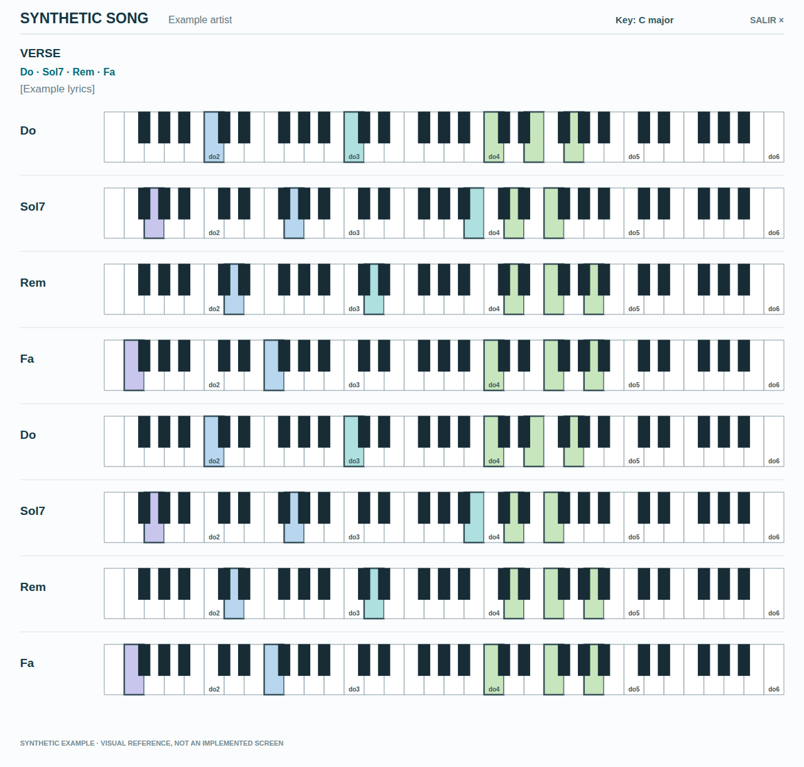

# Performance sketch: owner-selected direction

On 2026-11-21 the owner selected the wide-keyboard sketch as the ideal visual
reference for consulting chord positions on a landscape tablet. The image below
recreates that composition with invented music; it is a design reference, not
a screenshot of implemented functionality.

## Reading the song

- Treat the song as one continuous, vertically scrollable sheet. Keep its key,
  section names, and the chords in each section visible; include lyrics when
  available and align a chord with the sung text when appropriate.
- A repeated progression may be shown once as a loop, with its repetition count
  or exit cue and changing lyrics below it. Do not fabricate repetitions,
  lyrics, timings, or the user's arrangement.
- Notes and reminders are optional. A section may instead describe an
  instrumental passage, a precise phrase, or a band cue.

## Expanded chord positions

- Chord diagrams are optional by section or on demand. The selected expanded
  treatment shows one chord per row, in song order, with a short chord name at
  the left and one wide piano taking the remaining width.
- One piano can show exact performed notes for both hands together. Do not
  replace those notes with an inferred theoretical voicing or imply that color
  alone identifies the hand. Keep the associated hand information available.
- Show enough consecutive octaves to contain the intended notes; preserve
  pitches outside the visible range and indicate when a different range is
  needed. Make octave labels legible. Follow the authoritative
  [octave palette](piano-octave-colors.md) for all highlighted keys, including
  the entire surface of both white and black keys.
- In performance consultation the music is primary: avoid a persistent sidebar,
  large headers, or repeated note lists that reduce the width available for the
  piano. Keep an accessible way to leave the view and reach song navigation.

The image shows one possible expanded state, not a requirement to display every
piano all the time. Actual implementation must follow the accepted product
model and validated Product Change route, preserve protected performance mode,
and be verified on the target tablet and supported responsive sizes.
