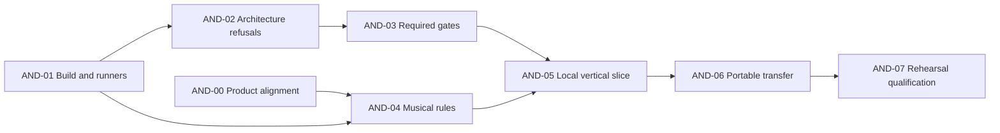

<!-- pdac-scope: cited -->

# Android delivery backlog

All items are planned and unimplemented. [Epic #79](https://github.com/juangcarmona/scoremap/issues/79) owns this backlog. AND identifiers are slice keys; native child issue numbers will be assigned by the trusted controller. No item is completed. Each row below is a reviewable implementation slice with its own relevant checks and acceptance evidence. The [design](design.md) and [enforcement contract](../../../docs/architecture/10-quality-requirements/android-enforcement.md) define their boundaries.

## AND-00: verify native local product alignment

The operator-hosted `issue-79-product-change` is a prerequisite, with its own exact-candidate decision, owning-provider apply and integration evidence. This native child verifies the resulting accepted baseline; it cannot author a second Product Change or alter canonical product files through ordinary implementation.

- [ ] Verify the integrated CHG-ANDROID-NATIVE-LOCAL baseline, exact operator decision under existing owner delegation, provider overlay/dry-run/apply receipts and affected OpenSpec/ArcShape citation bindings.
- [ ] Confirm the resolved always-independent-copy import, current-content export without private history, complete PDF/dependency transfer, history without expiry, recoverable song/set deletion, separate confirmed purge and existing private-service coexistence in the accepted artifacts.
- [ ] Derive the native SB/LC and preserved complete musical acceptance traceability for later TDD; report any actual semantic gap without modifying the accepted model or treating a successful tool invocation as product approval.

Acceptance: no unresolved product-semantic decisions for the selected first native journey; the accepted baseline describes the operation to be implemented. Dependencies: none. Blocks changed musician behavior; architecture documentation can be reviewed now.

<!-- pdac:cite id="CON-PLATFORM" digest="sha256:276120bdea8e88293e6843367e84966dacdad452cd568a124f64f73a24b529d5" -->
<!-- pdac:cite id="CON-LOCAL-FIRST" digest="sha256:3dd07ade8d6c189ac4f9b29fcf0e51d7abc3a6fd1a1f6ab7093918f0c4484c0a" -->
<!-- pdac:cite id="CON-SCOPE" digest="sha256:a69dd93c94d43ee6fe15eee09c94b68a5ac6f96cdd6f435627c3f790b707f664" -->
<!-- pdac:cite id="FR-PERSIST" digest="sha256:19c3bdee25cf34e4b6c6742a5da9a3c8905ba657d9056227fa0180474ed9b5e3" -->
<!-- pdac:cite id="FR-BACKUP" digest="sha256:57286bb21b4c895afe8d7831630bec01797580be96efa5fb5a321e9822dca7e1" -->
<!-- pdac:cite id="BR-BACKUP" digest="sha256:6e01f0285df7783f48eb0c482fa31f490f09e97e0f67a3a5fb3261dc1d1ed29c" -->
<!-- pdac:cite id="LC-LIBRARY" digest="sha256:87592e7d48ad80b922f219f370fee009668a74146f83cbb2f159e16752fbdda5" -->

<!-- pdac:cite id="SB-NATIVE-SONG-CREATE" digest="sha256:52e0a783f04ce368bd2ad7386a21b3fe19197774c922aa30e5665f08bda84545" -->
<!-- pdac:cite id="SB-NATIVE-SONG-DELETE" digest="sha256:d7a501ae15b77b376d58d0d0eccbe4c77ff5f2afb33d4d1eca0c54626ed089bd" -->
<!-- pdac:cite id="SB-NATIVE-SONG-RESTORE" digest="sha256:54dca733a71bb892ad6d39f734f654c1aacbdcb67e9cf650172853b55f189209" -->
<!-- pdac:cite id="SB-NATIVE-COPY-IMPORT" digest="sha256:b7edc6bb732117e937cf69b2e89ae49dcc7bd165fb3aa546dcb3cfc1555d47b9" -->

## AND-01: bootstrap isolated Android build and TDD runners

- [ ] Add `src/android` Gradle Wrapper/Kotlin DSL/settings/catalog and build-logic. Select and prove the supported stable toolchain; lock dependencies/plugins and wrapper checksum. Keep existing paths in place.
- [ ] Establish the section 05 module boundaries with the smallest compiling public surfaces and a Compose shell. Configure Kotlin warnings as errors, explicit API discipline, a pinned formatter, Detekt and debug/release Android Lint.
- [ ] Add JVM/coroutine and instrumented Room/Compose runners plus one meaningful failing-then-passing harness fixture. Provide runnable baseline `verifyHost`, root `verify:android` invoking that host aggregate, and Gradle-Managed-Device `verifyDevice` entry points from the first Android source commit, producing nonempty host/device JUnit reports without skipped tests for the delivered scope. AND-02/AND-03 expand these aggregates; do not count a dummy assertion as musician coverage.
- [ ] Audit TS, formatting, frontend-boundary, security and .NET discovery over `src`; record exact ownership of Kotlin/Gradle/resources and prove existing sources are still verified.

Acceptance: clean-checkout build and a synthetic shell run on the declared emulator; host tests need no emulator. New source has an owning verifier. No musical feature or permission is claimed. Dependencies: architecture target review; AND-00 before any changed product behavior.

## AND-02: enforce architecture with demonstrated refusals

- [ ] Implement AND-G01..G05 and AND-G08 from section 10 using convention plugins, compiler visibility, compiled ArchUnit rules and bounded Kotlin declaration rules.
- [ ] Add passing and failing fixtures for every rule. Include aliases/fully qualified types, annotations/inheritance, nested generic API leaks, unused forbidden project references, same-module shortcuts and a newly added module missing its quality convention.
- [ ] Run real fixture builds via Gradle TestKit. Capture expected diagnostic/rule and nonzero exit for forbidden code. An invalid fixture unexpectedly succeeding must fail verification.
- [ ] Test suppression, severity downgrade, omitted aggregate task and zero-test-suite attempts. Keep exceptions narrow and reviewable.

Acceptance: each rule has a documented owner, exercised positive/negative case and real refusal where compilation is the enforcement point. Host verification fails on an injected architecture violation. Dependencies: AND-01.

## AND-03: integrate required gates and artifact receipts

Operator prerequisite: admit the required implementation paths, verification
inputs, toolchain environment and CI budget before parent refinement freezes
the native epic source. Ordinary workers cannot change protected `.lighthouse`
or `.github` files. AND-03 verifies that admission and activates its allowed
Android/package entry points; policy changes require a separate operator route.

- [ ] Implement the section 10 `verifyHost`, `verifyDevice`, `verifyRelease` aggregates and root `verify:android`; keep existing required checks intact.
- [ ] Add pinned emulator execution and source-bound sanitized reports. Fail on missing/zero expected suites and skipped Android prerequisites. Exercise a failing root-policy or Android change through the actual CI graph.
- [ ] Configure implementation allowlists/checks explicitly for the foundation issues, including `src/android`, build-logic, root policy and selected OpenSpec change paths. Review effective policy so a worker cannot silently lack its task/spec path.
- [ ] Verify current required status configuration and independent review at the actual candidate head; do not infer enforcement from YAML. Produce an unsigned/debug artifact without committing credentials.

Acceptance: required CI reports a demonstrated injected failure and a subsequent clean pass; the downloadable artifact identifies its exact revision. Store signing/release installation remains separate. Dependencies: AND-02.

## AND-04: port pure musical rules with independent expectations

- [ ] Select accepted BR/SB/LC coverage and synthetic fixtures for the first native milestone. Write expected red tests for empty/first-song state, invalid names, stable section identity/order/repeats and protected performance commands.
- [ ] Port spelled harmony/exact pitches as separate values, including independent hand/register semantics and empty structures. Preserve supported lyric/phrase/binding associations when their selected content is carried; reject unsupported capabilities.
- [ ] Compare independently expected fixture values against both existing and Kotlin implementations; do not use the old algorithm's generated output as the sole oracle.

Acceptance: meaningful red/green/refactor receipt and native domain/application tests for admitted, refused and boundary outcomes. Dependencies: AND-00, AND-01.

<!-- pdac:cite id="BR-EDIT-GUARD" digest="sha256:20e678c4743404c64a51c01e4446026ac95811827d2f5e1c641839291ad32718" -->
<!-- pdac:cite id="BR-IDENTITY" digest="sha256:d9c6607eb0cc984270a900d1889980f7515f3c1648f31efe56ceb9f3818e0352" -->
<!-- pdac:cite id="BR-STRUCTURE" digest="sha256:db3410bd8a3fe7f3da94e63ee8804b1c75f03b8f7dd1e7858cfd05aed03a0686" -->
<!-- pdac:cite id="BR-CHORDS" digest="sha256:543566a20181aa25eab6cc446d8ac467b1ca911632744dd957a0ab3388e9d55c" -->
<!-- pdac:cite id="LC-STRUCTURE" digest="sha256:31caaa7320486ab3a837e8b0f3ac2b14f6e5623b664f131cb85af1ce030a24ef" -->
<!-- pdac:cite id="SB-SECTION-REORDER" digest="sha256:610413c7eae977e5760aa413f58ec499375fdafe0952dca8cbc7591cbda639e5" -->
<!-- pdac:cite id="FR-SONG-SHEET" digest="sha256:d1601737decd8d10473cdbbb1a417f4a33fa58c70f272f7378b44a7b78d9139c" -->
<!-- pdac:cite id="FR-PIANO-SCORE" digest="sha256:c7090b853deaf69a52df30a9a1ae62d24b51a0cb620dcb38a272ec1e0856cde5" -->
<!-- pdac:cite id="FR-PHRASE-REFERENCE" digest="sha256:16c20f0819f52467b0ac1ba823db8ac5defc7c6c01fd44ad310bdcf15fb35e5b" -->

## AND-05: deliver local music, sets and recoverable history

- [ ] Start with failing application and real Room tests for expected revision, whole-aggregate rollback, duplicate command retry, storage failure and restart/reopen; implement the local adapter and receipt boundary.
- [ ] Deliver Compose library/create/edit and protected consultation screens through the same application API. Reorder identified sections without losing associated content. Show failed versus acknowledged save states clearly.
- [ ] Prove cancellation and failure preserve durable data, process recreation does not erase acknowledged content, stale responses do not replace newer drafts and supported schema upgrades preserve a recovery copy.
- [ ] Use meaningful red/green/refactor tests and actual Room/PDF boundaries for song and ordered-set creation/editing, read-only history inspection, revision restore, recoverable delete, deleted-item restore and separate confirmed purge. Preserve all acknowledged revisions without expiry, validate current dependencies, keep independent resources and songs on set deletion/purge, never recreate former song memberships and retain non-content anti-resurrection receipts.
- [ ] Test direct performance-mode rejection, invalid/missing dependency restore, stale revisions, retry after ambiguous acknowledgement, cancelled/failed purge, crash/restart and low-storage failure for those song/set/history commands. Independently compare complete retained music, PDF bytes, set order and intervening revisions; no partial success or stale resurrection is allowed.

Acceptance: install the exact candidate; create/edit/save/restart/reopen complete synthetic songs and ordered sets, inspect/restore history, recoverably delete/restore and separately confirm purge without login or network, including real atomic refusal/failure/retry preservation. AND-G06 executed, including edit-guard rejection outside visible controls. Dependencies: AND-03, AND-04.

<!-- pdac:cite id="BR-EDIT-GUARD" digest="sha256:20e678c4743404c64a51c01e4446026ac95811827d2f5e1c641839291ad32718" -->
<!-- pdac:cite id="BR-DURABILITY" digest="sha256:d822f18f163b8685937ae5a3137dc04ef4a2d5947ab7a9954245bd965b72fa45" -->
<!-- pdac:cite id="SB-PERSIST-FAILURE" digest="sha256:31db2bb51e3c0495ac05dc1b53938c2de756eef9176e3ba747f6b877ee014357" -->
<!-- pdac:cite id="QR-INTEGRITY" digest="sha256:efafc9b7b32a7ff39fdb822f04ef46def7c7534b84b2e48a606fce99bea603e6" -->
<!-- pdac:cite id="QR-OFFLINE" digest="sha256:a3c8b14e8eb2c0b1a419ec1a266cf50ff4d0b739936b2f6cf0c0cdfc7db38827" -->

## AND-06: deliver complete editable song/set transfer

- [ ] Write failing codec/application/device tests for the approved transfer policy. Distinguish song versus set scope, complete dependencies/attachments, format version, source revision and destination identity mapping.
- [ ] Implement export, Android Sharesheet, document selection and incoming-file handling. Import validates and previews complete content before the selected atomic commit; existing unrelated songs remain as specified by AND-00.
- [ ] Test malformed/unknown/truncated/oversized input, duplicate IDs, dangling references, unsupported content, cancellation, repeated import and storage exhaustion. Preserve original files and prior database on refusal. Qualify required owned PDF staging, publication, crash cleanup and low-storage preservation; complete supported PDF transfer is mandatory.
- [ ] On two independent installations, export a synthetic song and complete ordered set from A, deliver through an available messaging/email document route, import into B with pre-existing unrelated music, edit there, re-export and reopen. Record unavailable external-app routes honestly.

Acceptance: reconstructed values are independently compared, not only accepted by a decoder. Both installations can edit their own local result. AND-G07 executed; sharing files does not imply live synchronization. Dependencies: AND-05.

<!-- pdac:cite id="BR-BACKUP" digest="sha256:6e01f0285df7783f48eb0c482fa31f490f09e97e0f67a3a5fb3261dc1d1ed29c" -->
<!-- pdac:cite id="BR-DURABILITY" digest="sha256:d822f18f163b8685937ae5a3137dc04ef4a2d5947ab7a9954245bd965b72fa45" -->
<!-- pdac:cite id="FR-BACKUP" digest="sha256:57286bb21b4c895afe8d7831630bec01797580be96efa5fb5a321e9822dca7e1" -->
<!-- pdac:cite id="FR-REPERTOIRES" digest="sha256:dcba63d54b9537950221b434cc50236f2aa2e4cdb1e53a229891b757e440f70f" -->
<!-- pdac:cite id="FR-MEMBERSHIP" digest="sha256:5616e543703cb1206e49a200d319d27a6bd55c401c3374b9ed3564583aab6b3e" -->

## AND-07: qualify rehearsal use and native feature parity

- [ ] Derive remaining editor/piano/staff/song-sheet/phrase work from accepted outcomes and issue #74's final integration. Add separate behavior slices; do not call the minimal create/save journey complete feature parity.
- [ ] Verify a signed release/update on the actual target tablet, offline reopen, failed-import preservation and actual touch/readability from playing distance. Agree measurable performance budgets after a release baseline; test changes against them.
- [ ] Review source independently, verify required checks at the integration head and qualify the distributed artifact. Record authored coverage, execution, review, merge, release, installation and musician acceptance separately.
- [ ] Scope MIDI/audio device trials as follow-up Product Changes; no hardware claim follows from this harness.

Acceptance: owner exercises the selected musical journeys on the target device; remaining capabilities and unperformed acceptance are explicit. Dependencies: AND-06 and the selected feature slices.

<!-- pdac:cite id="QR-READABILITY" digest="sha256:7139af1523273cf318b98b0f01da8688627c1a747f656b10017dcd3f0424c4af" -->
<!-- pdac:cite id="CON-CONTENT" digest="sha256:5c08415cc8047dfc3161440d4a427675c191cd7bfecef5d3c7bb139fe0a9752e" -->

## Delivery dependencies

The [machine-readable decomposition input](delivery-plan.json) validates against the installed Lighthouse decomposition and epic stack planners. It is a proposal, not a worker receipt or execution authorization. The eight stages above become native Lighthouse child issues after parent refinement.
The first documentation PR targets `main`; it must be integrated before the native
controller freezes its delivery source. Subsequent child PRs target the shared
`lighthouse/epic-<parent>` integration branch; the aggregate PR targets `main`.

AND-00 and the synthetic AND-01 scaffold can start independently. AND-04 may be
implemented alongside AND-02/AND-03 after its prerequisites are accepted; AND-05
joins their results. Serialize shared build/policy changes and branch writes.
Initial native epic capacity is one; raise it only after qualifying the supported
controller route. Each child still requires its own refinement, implementation
policy, checks and current-head owner acceptance. Product application is a
separate decision. No manually authored correlation marker confers authority.
