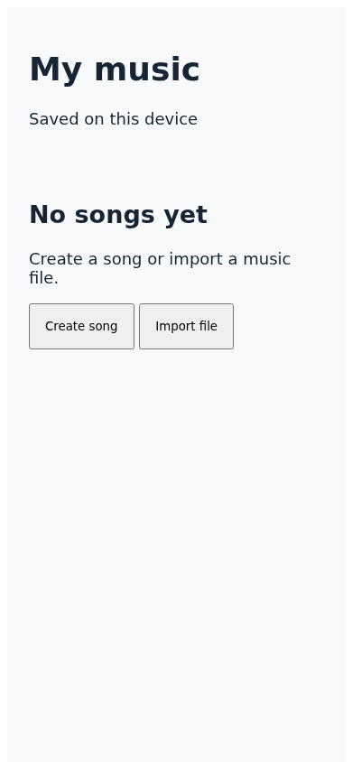
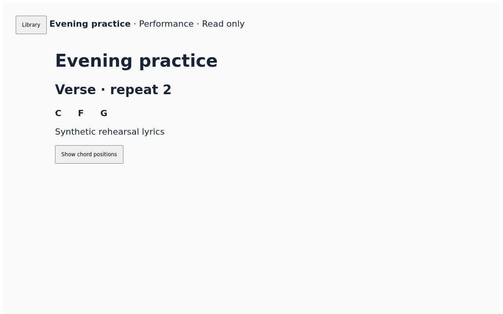

# Visual evidence for #79

Stage: refine. Source: `ccdcafb8b983818a2d65d7f4d0254e172d4cdd6a`. Candidate tree: `not an implementation`.

New Android library, editing, consultation and transfer interactions need proposed phone and tablet views; these wireframes are not implementation or approval.

## library-phone-empty: proposal

View: Native library. State: Empty local library. Viewport: 390 × 844. Producer: isolated proposed-design renderer.

## consult-tablet: proposal

View: Song consultation. State: Protected performance view of synthetic song. Viewport: 1280 × 800. Producer: isolated proposed-design renderer.

Proposed designs are illustrative. Candidate captures are agent-declared; the host verifies their bytes and binds them to the independently checked candidate tree. Images grant no visual acceptance, merge or release approval.
