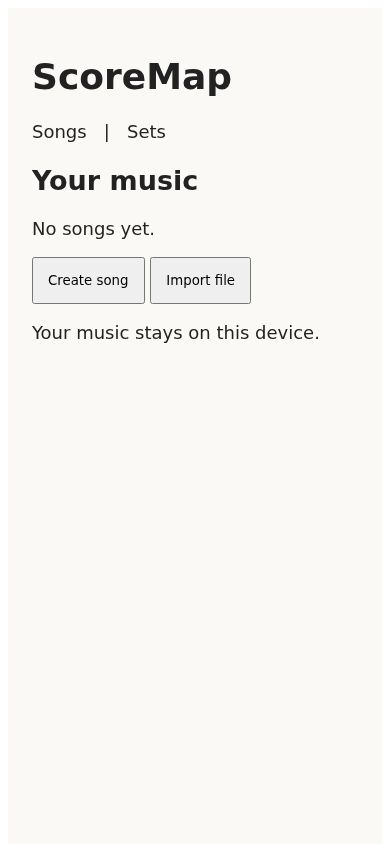
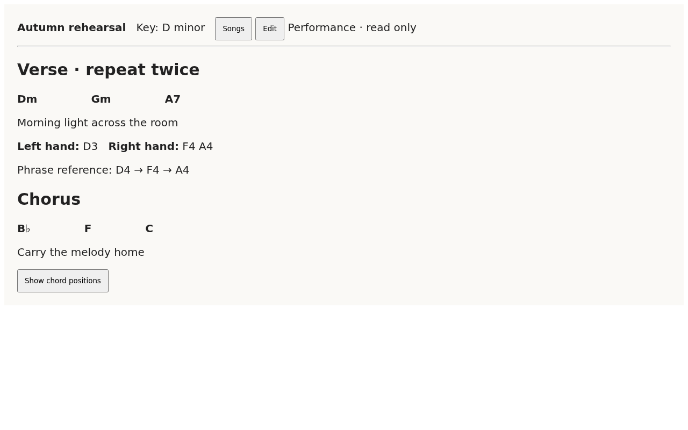
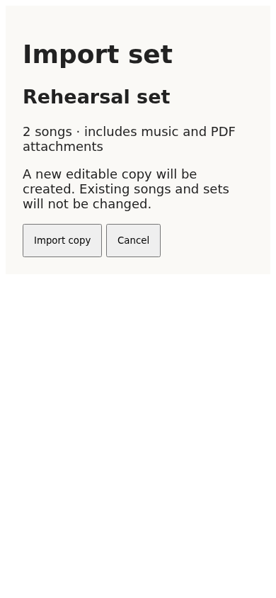

# Visual evidence for #79

Stage: refine. Source: `ccdcafb8b983818a2d65d7f4d0254e172d4cdd6a`. Candidate tree: `not an implementation`.

New native phone library, import and tablet consultation change user-facing screens and interaction states; these are planning examples, not actual Compose captures.

## library-phone-empty: proposal

View: Native library. State: Empty library with separate create and import actions. Viewport: 390 × 844. Producer: isolated proposed-design renderer.

## consult-tablet: proposal

View: Native song consultation. State: Protected consultation with expanded musical sheet. Viewport: 1280 × 800. Producer: isolated proposed-design renderer.

## import-phone-preview: proposal

View: Native import. State: Preview independent copy and preserve existing music. Viewport: 390 × 844. Producer: isolated proposed-design renderer.

Proposed designs are illustrative. Candidate captures are agent-declared; the host verifies their bytes and binds them to the independently checked candidate tree. Images grant no visual acceptance, merge or release approval.
