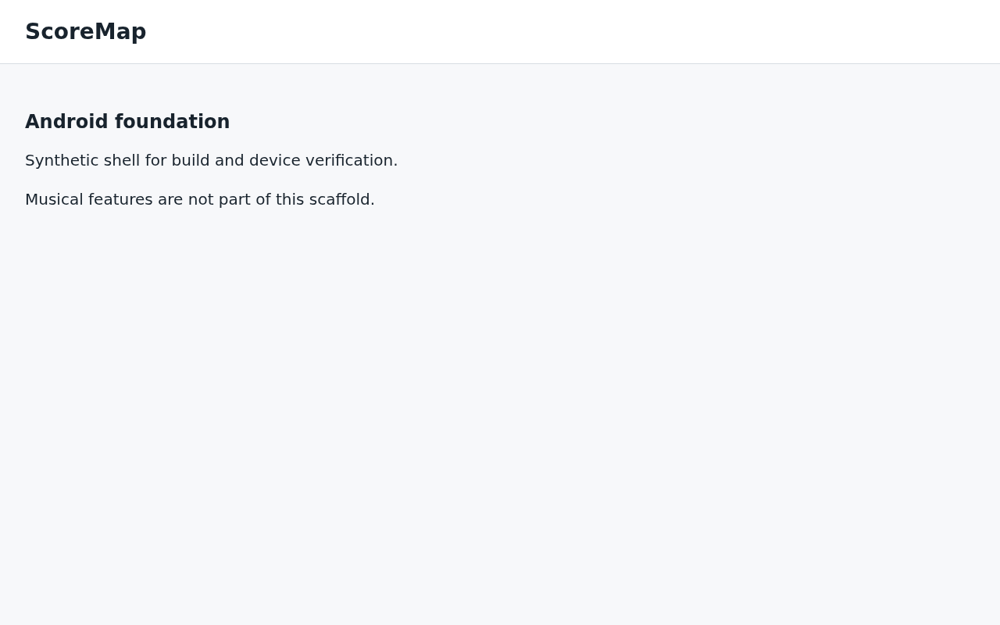

# Visual evidence for #84

Stage: refine. Source: `ccdcafb8b983818a2d65d7f4d0254e172d4cdd6a`. Candidate tree: `not an implementation`.

The new synthetic Compose shell has a visible startup state; this example is a proposed test scaffold, not a musician workflow or approved design.

## synthetic-shell-tablet: proposal

View: Synthetic Android shell. State: Launched, no musical functionality. Viewport: 1280 × 800. Producer: isolated proposed-design renderer.

Proposed designs are illustrative. Candidate captures are agent-declared; the host verifies their bytes and binds them to the independently checked candidate tree. Images grant no visual acceptance, merge or release approval.
