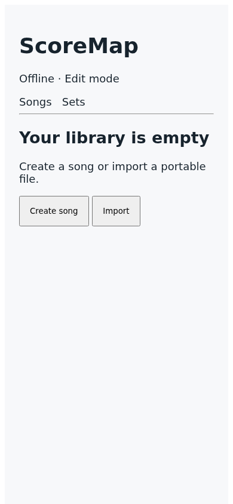
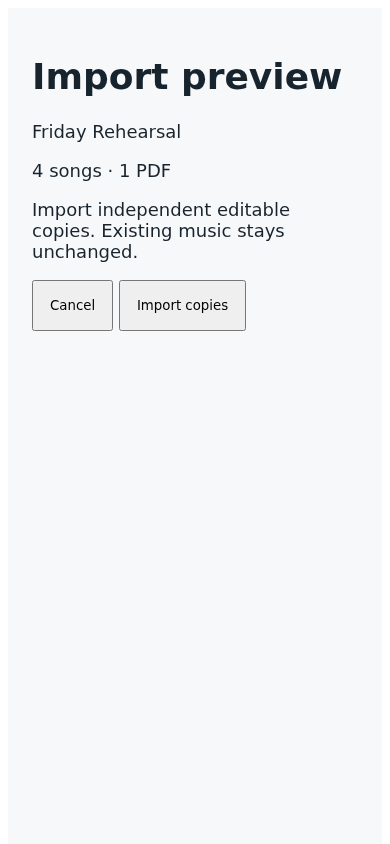
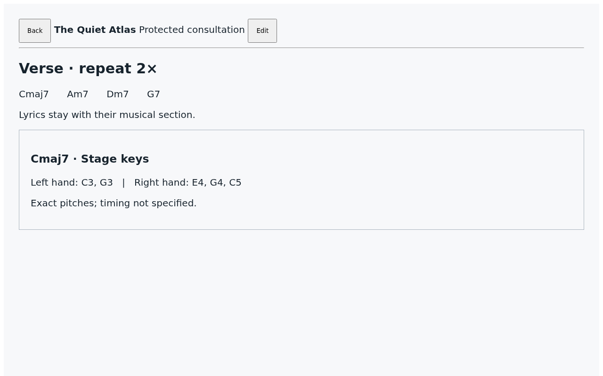

# Visual evidence for #92

Stage: refine. Source: `39e3ee8f6dc72e29a04a93da36991d3eeb653ea8`. Candidate tree: `not an implementation`.

Planning proposals illustrate new phone and tablet interaction states; these are not product captures or visual approval.

## phone-library-empty: proposal

View: Native library. State: Empty offline library in edit mode. Viewport: 390 × 844. Producer: isolated proposed-design renderer.

## phone-import-preview: proposal

View: Import. State: Validated set preview before confirmation. Viewport: 390 × 844. Producer: isolated proposed-design renderer.

## tablet-protected-sheet: proposal

View: Song sheet. State: Protected consultation. Viewport: 1280 × 800. Producer: isolated proposed-design renderer.

Proposed designs are illustrative. Candidate captures are agent-declared; the host verifies their bytes and binds them to the independently checked candidate tree. Images grant no visual acceptance, merge or release approval.
