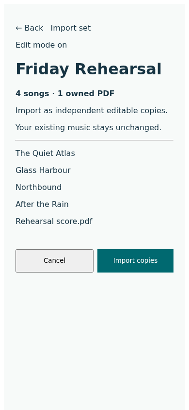
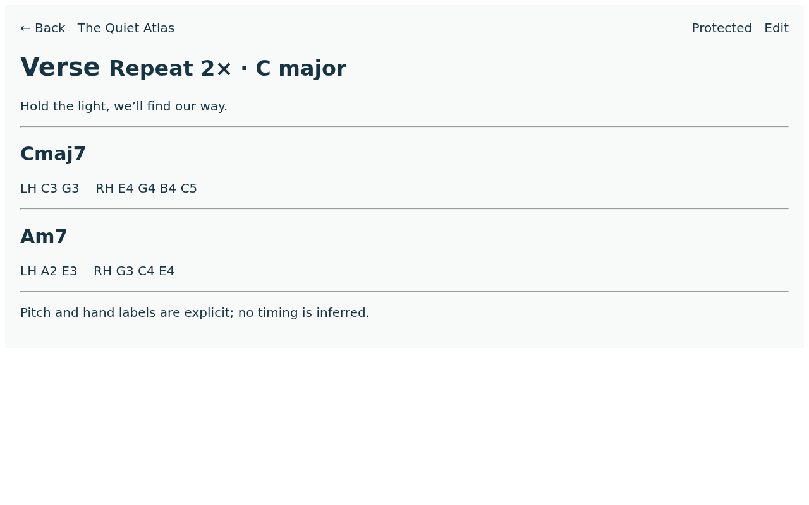

# Visual evidence for #92

Stage: refine. Source: `3b516bac3927ca79825f0cb72550af2882548a13`. Candidate tree: `not an implementation`.

Native library, editor, protected consultation and import preview/error change user-facing interaction. Inline examples are planning proposals, not native captures.

## phone-import-preview: proposal

View: Import set. State: Preview before independent-copy commit. Viewport: 390 × 844. Producer: isolated proposed-design renderer.

## tablet-consultation: proposal

View: Protected song consultation. State: Verse with exact hand-labelled pitches. Viewport: 1280 × 800. Producer: isolated proposed-design renderer.

Proposed designs are illustrative. Candidate captures are agent-declared; the host verifies their bytes and binds them to the independently checked candidate tree. Images grant no visual acceptance, merge or release approval.
