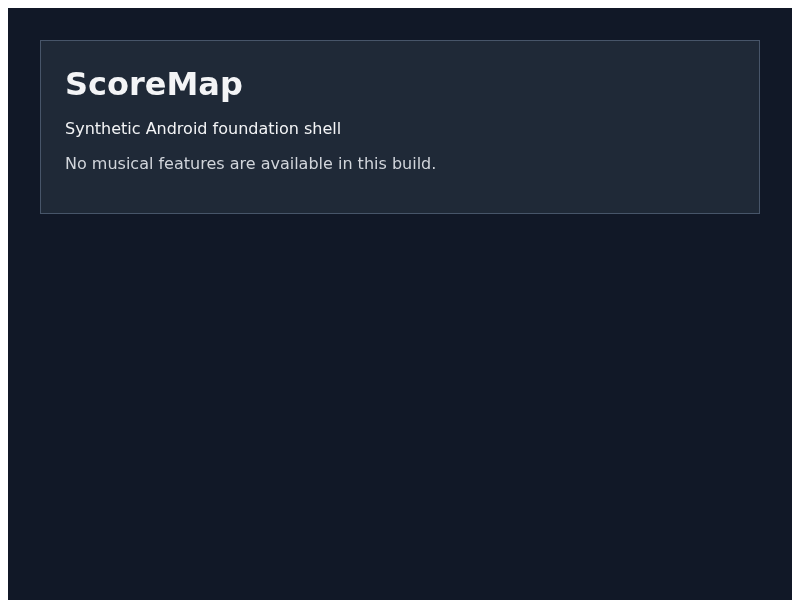

# Visual evidence for #95

Stage: refine. Source: `3b516bac3927ca79825f0cb72550af2882548a13`. Candidate tree: `not an implementation`.

The requested synthetic Compose shell introduces a visible placeholder, but no musical screen or interaction. This example is proposed only; it is not a screenshot or approved product design.

## synthetic-shell: proposal

View: Android synthetic foundation shell. State: Placeholder with no musical features. Viewport: 800 × 600. Producer: isolated proposed-design renderer.

Proposed designs are illustrative. Candidate captures are agent-declared; the host verifies their bytes and binds them to the independently checked candidate tree. Images grant no visual acceptance, merge or release approval.
