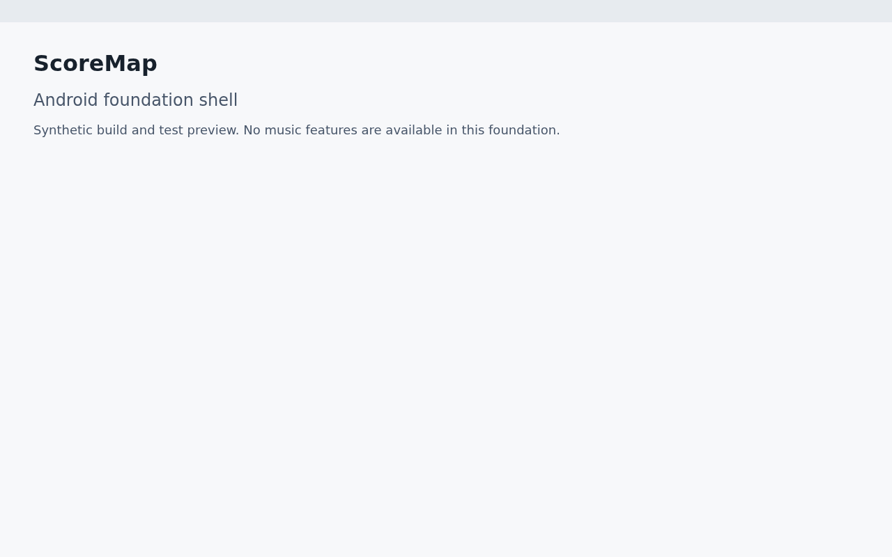

# Visual evidence for #95

Stage: refine. Source: `3b516bac3927ca79825f0cb72550af2882548a13`. Candidate tree: `not an implementation`.

The new synthetic Compose shell has a visible tablet surface. This is a proposed example, not a product screenshot or a musical feature.

## synthetic-shell-tablet: proposal

View: Android foundation shell. State: Initial synthetic shell, no musical content or modal. Viewport: 1280 × 800. Producer: isolated proposed-design renderer.

Proposed designs are illustrative. Candidate captures are agent-declared; the host verifies their bytes and binds them to the independently checked candidate tree. Images grant no visual acceptance, merge or release approval.
