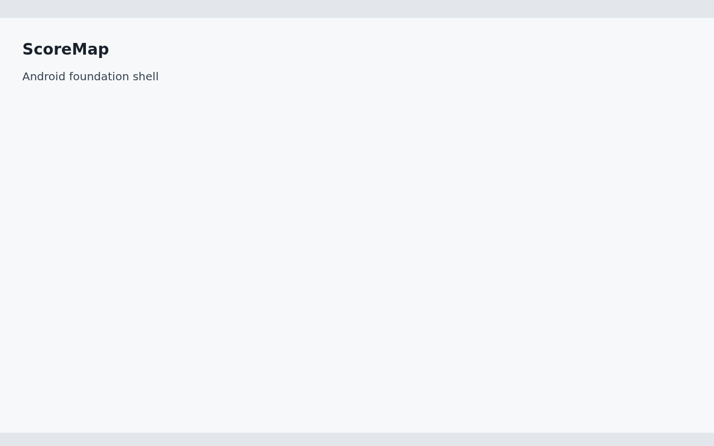

# Visual evidence for #95

Stage: refine. Source: `3b516bac3927ca79825f0cb72550af2882548a13`. Candidate tree: `not an implementation`.

A new synthetic Compose shell has a visible initial state; this is an illustrative planning example, not a proposed music workflow or a running-product capture.

## synthetic-shell-tablet: proposal

View: Synthetic Android foundation shell. State: Initial placeholder below system bars; no musical feature or modal. Viewport: 1280 × 800. Producer: isolated proposed-design renderer.

Proposed designs are illustrative. Candidate captures are agent-declared; the host verifies their bytes and binds them to the independently checked candidate tree. Images grant no visual acceptance, merge or release approval.
